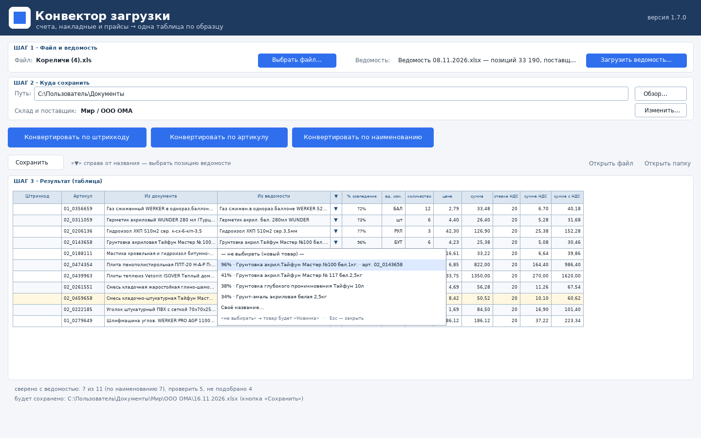

# Конвертор загрузки

Программа для Windows, которая приводит счета, накладные (ТТН/ТТН-1), приложения к ТТН
и прайс-листы поставщиков **к одной таблице Excel по образцу** — независимо от того,
как эти файлы оформлены у разных поставщиков. Дополнительно программа **проверяет
арифметику** документа: количество × цена, НДС по ставке, сумму с НДС и итоги.

Итоговая таблица (образец заказчика):

| Штрихкод | Артикул | Наименование товара | ед. изм. | количество | цена | сумма | ставка НДС | сумма НДС | сумма с НДС |
|---|---|---|---|---|---|---|---|---|---|

## Как получить программу

1. Откройте вкладку **Actions** → последняя успешная сборка **«Сборка Windows-приложения»**.
2. Внизу страницы сборки скачайте артефакт **`Konvertor-windows`** (или готовый
   `Konvertor-windows.zip`, если это релиз).
3. Распакуйте в любую папку и запустите **`Konvertor.exe`** — установка не нужна.

Сборка запускается автоматически после каждого изменения в репозитории
(см. `.github/workflows/build.yml`). Файлы для Windows собираются на `windows-latest`
через PyInstaller, поэтому `.exe` всегда соответствует текущему коду.



Окно открывается **развёрнутым на весь экран**: сверху три способа конвертации,
ниже плашка «ШАГ 1» (слева файл, справа ведомость), затем «ШАГ 2» — путь
сохранения и строка «склад / поставщик».

## Как пользоваться

1. Запустить `Konvertor.exe`.
2. Нажать **«Выбрать файл…»** и указать один счёт/накладную/прайс
   (файл можно и перетащить мышью на ярлык `Konvertor.exe`). Сразу после
   выбора программа спросит **склад** — «Мир» или «Кореличи» — и предложит
   **выбрать поставщика из загруженной ведомости** (пункт «— как в документе —»
   оставляет поставщика, найденного в самом счёте).
3. В поле **«Куда сохранить»** подставлена папка **«Документы»** — её можно
   стереть (тогда результат снова пойдёт в «Документы») или вписать любой путь,
   в том числе на другом диске: `D:\Отчёты\Конвертор`. Кнопка **«Обзор…»**
   рядом с полем открывает привычный выбор папки и подставляет путь в поле.
   Если склад выбран, программа сама раскладывает результат по папкам:
   **`<папка>/<склад>/<склад поставщик дата>.xlsx`** — например
   `D:\Отчёты\Конвертор\Мир\Мир ООО ОМА 15.11.2026.xlsx`. Дата — дата сохранения.
   Без выбранного склада имя — `поставщик дата.xlsx`.
   Если такой файл уже есть, новый сохраняется как `… 15.11.2026 (2).xlsx` —
   **старый результат не затирается**. Склад и поставщика можно поменять в
   любой момент кнопкой **«Изменить…»** в строке «Склад и поставщик».
4. Нажать одну из трёх кнопок — **«Конвертировать по штрихкоду»**,
   **«по артикулу»** или **«по наименованию»** (если ведомость не загружена,
   все три делают обычную конвертацию). Внизу окна вместо журнала сразу показывается
   готовая таблица, с разлиновкой (подсветка строк через одну и рамка).
   В окне у наименования две колонки — «Из документа» и «Из ведомости» —
   и процент совпадения; **в сохранённом файле ровно 10 колонок образца**.
   Список файлов очищается сам — можно выбирать следующий.
5. Проверить таблицу и нажать **«Сохранить»** — только после этого файл
   записывается на диск (папка и имя показаны в подсказке под таблицей).
   В файле **10 колонок** образца; после «сумма с НДС» добавляется только
   колонка «Новинка» и только при сверке с ведомостью.

### Сверка с ведомостью остатков ТМЦ

Если нужно, чтобы номенклатура называлась так же, как в учётной системе:

1. Нажать **«Загрузить ведомость…»** и выбрать выгрузку остатков
   («Склад», «Артикул», «Номенклатура», «Ед.», «Цена последнего поставщика»,
   «Последний поставщик»; строк может быть 30 тысяч и больше).
2. Выбрать счёт/накладную и нажать нужную кнопку конвертации — программа
   подбирает номенклатуру **по поставщику документа**, а внутри него — по
   штрихкоду, артикулу или названию (сокращения «акрил.»/«акриловая»,
   латиница/кириллица и числа учитываются).
3. Смотреть таблицу: в ней **две колонки наименования** — «Из документа» и
   «Из ведомости» — узкая колонка **«▼»** и **«% совпадения»**. Щелчок по «▼»
   открывает список похожих позиций ведомости: процент совпадения, артикул,
   пункт «— не выбирать (новый товар) —» и «Своё название…». Список
   закрывается сам, как только таблицу прокрутили, — не «висит» на месте.
   Двойной щелчок по «Из ведомости» тоже открывает список (и поле для своего
   названия). Ручные правки подсвечены.
4. Нажать **«Сохранить»** — в файл попадут выбранные названия, а
   артикул, штрихкод и единица подставятся, если в документе их не было.
   Там, где номенклатуру не выбрали или не нашли, в колонке «Новинка»
   будет написано **«Новинка»** — товара нет в ведомости.

В консоли то же самое: `Konvertor-cli.exe счет.xls --vedomost "Ведомость.xlsx"
--match name --sklad Мир -o "D:\Отчёты"` (`--supplier "ООО ОМА"` — если
поставщика нужно задать вручную).

Получится книга Excel с листом данных:

* **Данные** — таблица по образцу (шапка, позиции, строка «ИТОГО» с формулами,
  закреплённая шапка; автофильтра нет). Ячейки с **жёлтой заливкой** — значения,
  которых в документе не было и которые посчитала программа.

Поставщик определяется по самому документу (подписи «Поставщик»/«Продавец»/
«Грузоотправитель», оборот «между А и Б», верхняя часть листа). Наша
организация — «Мирстроймаркет», «Мирсититорг» — поставщиком не считается
никогда; свой список задаётся переменной `KONVEKTOR_OUR_COMPANIES`.

Готовый пример результата, собранного из всех файлов этого репозитория:
[`examples/Пример_результата.xlsx`](examples/Пример_результата.xlsx) — откройте его,
это пример из предыдущей версии; новые файлы содержат только данные.

Подробная инструкция — [`docs/Пользователю.md`](docs/Пользователю.md).
Как устроен анализ таблиц (слои, гипотезы, метрики, порог «требует проверки») —
[`docs/КОНЦЕПЦИЯ.md`](docs/КОНЦЕПЦИЯ.md).

## Что поддерживается

| Что                       | Как читается                                                   |
|---------------------------|----------------------------------------------------------------|
| `.xls` (Excel 97-2003)     | xlrd; отдельно обрабатываются «кривые» выгрузки 1С и файлы без CODEPAGE (cp1251) |
| `.xlsx`, `.xlsm`           | openpyxl (значения формул берутся из кэша)                     |
| HTML-таблицы (`.html`, `.htm`, `.mht`) | встроенный парсер таблиц; часто так отдают прайсы, замаскированные под `.xls` |
| `.csv`, `.txt`, `.tsv`     | автоопределение кодировки (UTF-8/cp1251) и разделителя           |
| «не тот» формат внутри файла | формат определяется по содержимому, а не по расширению         |
| ведомость остатков ТМЦ     | xlsx/xls/csv; колонки ищутся по названиям заголовков             |

Понимаются документы, у которых:

* шапка может быть в любой строке и называться по-разному
  («Штрихкод»/«Штрих-код»/«EAN», «Артикул»/«Код», «Наименование товара»/«Номенклатура»/«Товар»,
  «ед. изм.»/«Ед.», «Количество»/«Кол-во»/«К-во», «Цена», «Сумма»/«Стоимость»,
  «Ставка НДС», «Сумма НДС»/«НДС», «Сумма с НДС»/«Всего»);
* таблица повторяется на нескольких страницах (ТТН-1, приложения к ТТН) —
  читаются все страницы;
* штрихкод лежит в отдельной колонке **или вписан в наименование**
  (`…, 4607011539220, страна происх. РОССИЯ`, `/4607141950148/`, `штрих-код 4610273692930`);
* артикул лежит в колонке **или вписан в наименование** (`арт. 08135`, `8160612 Вода…`);
* числа записаны как `1 006,75`, `68,80`, `20 %`, `1.006,75`;
* часть колонок отсутствует (например, нет «суммы» — она считается как количество × цена).

## Математическая проверка

Для каждой строки проверяется:

```
сумма       ≈ количество × цена
сумма с НДС ≈ сумма + сумма НДС          (или = сумме, если НДС «в том числе»)
сумма НДС   ≈ сумма × ставка / 100        (НДС сверху)
сумма НДС   ≈ сумма × ставка / (100+ставка) (НДС в том числе)
```

Режим «НДС сверху / НДС в том числе» определяется по самому документу (какой вариант
даёт меньше расхождений). Дополнительно найденные итоговые строки документа
(«Итого», «Всего с НДС», «ИТОГО ПО СТРАНИЦЕ»…) сверяются с суммой строк.

Допуск — 2 копейки на строку (округления поставщика). Всё, что вышло за допуск,
показывается в предупреждении программы; отсутствующие значения
рассчитываются (**РАСЧЁТ**, жёлтая заливка).

## Консольная версия

```
Konvertor-cli.exe счет.xls ТТН.xlsx -o Загрузка.xlsx
Konvertor-cli.exe папка_со_счетами -o Итог.xlsx --mode sheets
Konvertor-cli.exe счет.xls --source-columns   # дополнительно колонки «файл»/«строка» (по умолчанию их нет)
Konvertor-cli.exe --selftest .            # самопроверка на файлах-образцах
Konvertor-cli.exe --explain "файл.XLS"    # как разобран файл: роли колонок, арифметика, доверие
Konvertor-cli.exe --diagnose "файл.XLS"   # почему файл не читается (формат, листы, ошибка)
Konvertor-cli.exe --help
```

`--mode combined` (по умолчанию) — все файлы в один лист; `sheets` — по листу на файл;
`files` — отдельный `.xlsx` на каждый исходный файл. `--json` печатает машиночитаемый итог,
`--strict` возвращает код 3, если найдены расхождения в суммах.

## Разработка

```bash
python -m venv .venv
.venv/bin/pip install -r requirements-dev.txt
.venv/bin/python -m pytest            # 332 теста, включая разбор всех файлов-образцов
.venv/bin/python -m konvektor.cli --selftest .
```

Сборка `.exe` вручную:

```bash
pyinstaller --onefile --noconsole --name Konvertor --icon assets/konvektor.ico app_gui.py
pyinstaller --onefile --console --name Konvertor-cli --icon assets/konvektor.ico app_cli.py
```

Документация для разработчиков и агентов:

* [`docs/ARCHITECTURE.md`](docs/ARCHITECTURE.md) — устройство программы и алгоритмы;
* [`docs/FORMATS.md`](docs/FORMATS.md) — разбор всех образцов, особенности поставщиков;
* [`docs/DEVELOPMENT.md`](docs/DEVELOPMENT.md) — тесты, сборка, CI, типовые проблемы;
* [`AGENTS.md`](AGENTS.md) — передача работы следующему агенту;
* [`CHANGELOG.md`](CHANGELOG.md) — история изменений.

## Текущее состояние

На 10 файлах-образцах (ТТН-1, приложения к ТТН, ТТН с ЭЦП, счета четырёх поставщиков,
прайсы, один повреждённый `.xls`) программа распознаёт **301 позицию**,
**0 расхождений** в арифметике, **140 значений** достроено расчётом.
Это зафиксировано тестами в `tests/test_samples.py` и `tests/test_pipeline.py`.
